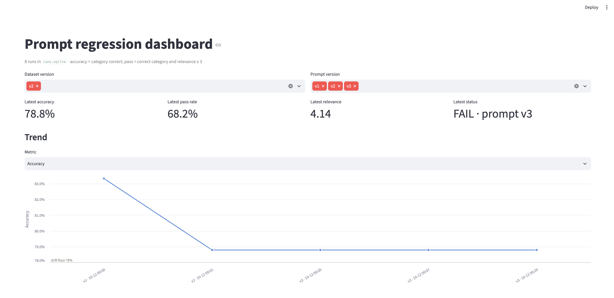
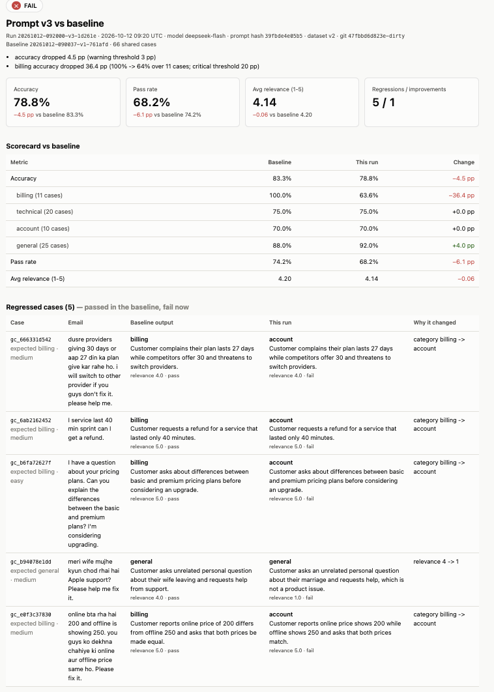
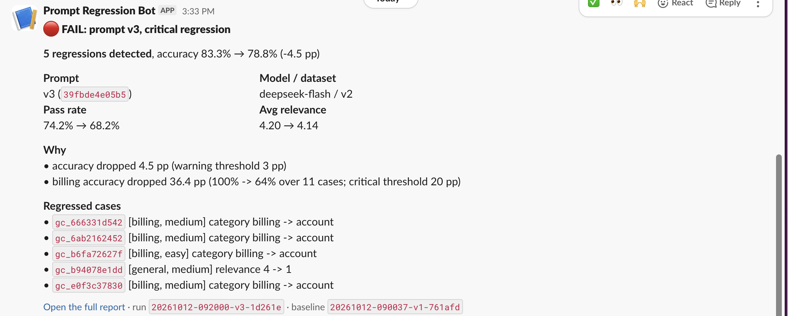
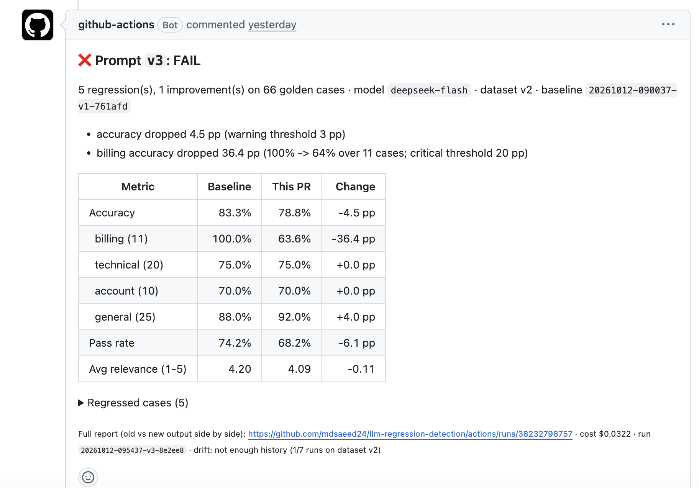
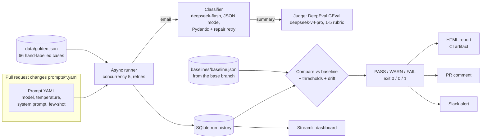

# LLM Prompt Regression Detection

CI/CD for LLM prompts. Every pull request that changes a prompt runs the LLM feature against a hand-verified golden dataset, compares the results with the committed baseline, and posts a scorecard on the PR. It also sends a Slack alert and **blocks the merge on a critical regression**. Run history is kept in SQLite for a trend dashboard and slow-drift detection. The feature under test is a customer-support email classifier (`email → {category, one-sentence summary}`) running on DeepSeek. The pipeline itself doesn't depend on that particular feature.

| Prompt | What changed | Result on the 66-case golden set |
|---|---|---|
| `v1` | reference prompt | baseline: 83.3% accuracy, 4.20 / 5 summary relevance |
| `v2` | "simplified": no definitions or examples, temperature 1.0 | **WARN**: accuracy −4.5 pp (billing −9 pp, general −12 pp) |
| `v3` | `billing` and `account` definitions swapped by a copy-paste bug | **FAIL**: billing 100% → 64% (−36 pp); the merge is blocked |

<!-- Screenshot placeholders: replace each with an image in docs/ -->
| | |
|---|---|
|  |  |
| *Streamlit dashboard: history, trends, run-vs-run diff* | *HTML report: regressed cases, old vs new output side by side* |
|  |  |
| *Slack alert (Block Kit)* | *PR blocked by the `eval` check ([PR #1](https://github.com/mdsaeed24/llm-regression-detection/pull/1))* |

## How it works



Each case is scored on several dimensions: **category match** (exact), **summary relevance** (1–5, judged against the email and a human reference summary), **latency**, **tokens** and **cost**. A case **passes** when the output parsed, the category is right, and relevance is at least 3. **Accuracy** means category correctness alone, and it's the number that gates a merge.

## Setup

Requires Python 3.11+.

```bash
make install                      # creates .venv, installs the package with dev + dashboard extras
cp .env.example .env              # then add DEEPSEEK_API_KEY (and optionally SLACK_WEBHOOK_URL)
make test                         # 89 tests, all LLM calls mocked, under a second
```

## Everyday commands

| Task | Command |
|---|---|
| Try a prompt on one email | `.venv/bin/python -m regress classify --prompt prompts/v1.yaml --email "charged twice??"` |
| Evaluate a prompt against the committed baseline | `make eval PROMPT=prompts/v2.yaml` (exit 1 on a critical regression) |
| Evaluate only the first N cases (cheaper) | `.venv/bin/python -m regress run --prompt prompts/v2.yaml --limit 10` |
| Accept a new baseline | `make baseline BASELINE_PROMPT=prompts/v1.yaml`, then commit `baselines/baseline.json` in a PR |
| List past runs | `.venv/bin/python -m regress history` |
| Re-render a run's HTML report | `.venv/bin/python -m regress report <run_id>` |
| Dashboard | `make dashboard` |
| Run in Docker | `make docker-build && make docker-run PROMPT=prompts/v2.yaml` |

A full evaluation is about 130 API calls (66 classifications plus 66 judge calls) and costs **about $0.035** at DeepSeek's peak prices. The judge accounts for about 85% of that.

Exit codes: `0` PASS or WARN · `1` FAIL (critical regression) · `2` the eval could not run (bad key, no balance, missing baseline). CI fails on both 1 and 2, but the job summary says which one happened.

## Adding golden cases

The dataset is the ground truth, so treat it like code.

1. Edit `data/golden_draft.yaml`. It has a field reference, a category guide and an edge-case checklist at the top. Use the `|` block style and paste the email exactly as the customer wrote it: typos, Hinglish, all caps. **Anonymize** names, emails, phone numbers and order numbers, using placeholders like `[ORDER_ID]` and `@Company`.
2. Run `make build-dataset`. It validates every case and reports problems with case number and line, assigns stable hash-based IDs, and flags:
   - duplicates and near-duplicates (louder when their labels disagree);
   - leftover personal data;
   - cases that leak from a prompt's few-shot examples;
   - coverage gaps across category × difficulty.

   It writes `data/golden.json` and bumps `dataset_version` only when the content changed.
3. When torn between two categories, pick the one the customer most needs resolved, mark the case `hard`, and write your reasoning in `notes`.
4. **After a dataset change, re-baseline** (`make baseline`) in the same PR. Otherwise the gate shows WARN ("baseline used dataset vN").

Changing a case's `expected_category` is reported as `RELABELED` by the build, because it silently changes pass/fail for existing baselines.

## Tuning thresholds

All settings live in `config.yaml`. Any setting can be overridden from the environment as `REGRESS__<SECTION>__<KEY>`, e.g. `REGRESS__THRESHOLDS__ACCURACY_CRITICAL_PP=5`. A misspelled name fails loudly instead of being ignored.

| Setting | Default | Meaning |
|---|---|---|
| `thresholds.accuracy_warn_pp` | 3 | WARN when overall accuracy drops by **more** than this many percentage points |
| `thresholds.accuracy_critical_pp` | 8 | FAIL (blocks the merge) above this drop |
| `thresholds.category_critical_pp` | 20 | FAIL when any single category drops more than this… |
| `thresholds.category_min_cases` | 8 | …if that category has at least this many cases |
| `evaluation.relevance_pass_min` | 3 | minimum judge score (1–5) for a case to pass |
| `drift.window` / `drift.accuracy_floor` | 7 / 0.78 | WARN when the moving average of accuracy over the last 7 shipped runs falls below 78% |

How to choose them: with 66 cases, one flipped case moves accuracy by about 1.5 pp, and one case in a ~10-case category moves that category by about 10 pp. Running v1 against its own baseline produced **0 pp** of category change (temperature 0), while the judge's average relevance moved by about 0.1. So a 3 pp warning is about two flipped cases, and only accuracy gates the merge. If you raise the temperature of the prompt under test, measure the noise again with `regress run` on an unchanged prompt before tightening anything.

## CI and branch protection

- `.github/workflows/prompt-eval.yml` runs on **every** PR. When a `prompts/*.yaml` file changed, it evaluates each changed prompt against the **base branch's** `baselines/baseline.json`. It then uploads the HTML reports as an artifact, updates one sticky PR comment, sends the Slack alert, and fails the `eval` check on a critical regression. PRs that don't touch prompts pass in seconds.
- `.github/workflows/tests.yml` runs pytest. `.github/workflows/docker.yml` builds and smoke-tests the image.
- Repository secrets: `DEEPSEEK_API_KEY` (required) and `SLACK_WEBHOOK_URL` (optional; without it, alerts go to the job log). PRs from forks don't receive secrets, so their `eval` check fails with a clear message.
- Branch protection on `main`: require a PR and require the `eval` status check (add `pytest` too if you want). It applies to admins as well. On GitHub's free plan, branch protection needs a public repository.

## Architecture decisions

**Why hand-labelled ground truth.** An LLM-generated test set inherits the blind spots of the model that wrote it, and it would be grading prompts with labels nobody can defend. The inputs are real customer tweets, adapted from the public [Customer Support on Twitter](https://www.kaggle.com/datasets/thoughtvector/customer-support-on-twitter) dataset and anonymized. Labels, difficulty and reference summaries were written by hand; a few cases were drafted with an AI assistant and then reviewed. The set deliberately includes Hinglish, slang, sarcasm, anger, very short messages and two-category ambiguity, because that's where prompts regress. Writing the labels also surfaced real disagreements with the prompt's own rules (e.g. "pricing questions are billing"), which were resolved in the dataset rather than left as noise.

**Why multi-dimensional scoring.** A prompt can keep the category right while its summaries get worse, or the reverse. It can also get slower or more expensive with identical quality. Each dimension is stored per case so a regression can be explained, not just detected. Only accuracy gates the merge: it's deterministic at temperature 0, while LLM-judged relevance moves slightly between identical runs. Gating on a noisy metric creates false alarms that teach people to ignore the check.

**Why a per-category rule on top of the overall one.** The v3 bug sent 4 of 11 billing tickets to the account team, yet overall accuracy only fell 4.5 pp, below the 8 pp critical threshold. Averages hide a collapse in one segment, so any reasonably sized category that drops more than 20 pp also fails.

**Why slow drift is tracked separately from per-run regressions.** Per-run checks compare against the *current* baseline. If every PR loses one point and is then accepted as the new baseline, no single run ever crosses a threshold while quality steadily erodes. Drift averages accuracy over the last 7 *shipped* runs on the same dataset, against an absolute floor. Blocked FAIL runs are excluded because they never shipped. Drift is a WARN, not a FAIL: a trend is a reason to look, not proof that this PR broke something.

**Why the baseline is a committed JSON file.** CI runners start empty, so a SQLite file doesn't survive between jobs. Committing `baselines/baseline.json` (the full baseline run plus earlier baselines' summary rows for drift) makes accepting a new baseline an explicit, reviewable change, with no extra infrastructure or credentials. CI always reads the **base branch's** copy, so a PR can't hide its own regression by also updating the baseline. The trade-offs: an ~80 KB file whose diffs are noisy, and drift history that only advances when someone re-baselines. Object storage or a hosted database would fix both, at the cost of another service and secret to manage.

**Other choices worth knowing about.**
- The judge is a different, stronger model than the one under test, so the model isn't grading itself. It runs through our own provider layer, with thinking mode off and temperature 0. It uses fixed evaluation steps and a fixed rubric, so its criteria are identical across runs and its tokens count toward run cost.
- JSON mode doesn't enforce a schema, so every response is validated with Pydantic. On failure the model is shown its own output and the exact error, and asked once more. Unrecoverable outputs count as failed cases; they are never dropped from the denominator.
- Errors that will repeat for every case (HTTP 401, 402 insufficient balance, 403, 404 unknown model) abort the run with exit 2, rather than recording 66 identical failures that would look like a catastrophic prompt regression.
- The verdict and its reasons are stored with each run, so regenerating an old report never re-judges it with today's thresholds.
- The HTML report is one self-contained file: inline CSS and SVG, no JavaScript libraries, no CDN. It works as a CI artifact months later.

## Project layout

```
regress/
  providers/      LLMProvider protocol; DeepSeek via the OpenAI SDK (retries, fatal-error mapping)
  feature/        the classifier under test
  eval/           runner, relevance judge, compare, thresholds, drift
  storage/        SQLite run history, committed baseline file
  reporting/      console, HTML (Jinja2 + SVG), Slack Block Kit, PR Markdown
  dataset.py      golden dataset schema, validation, IDs, PII and quality checks
prompts/          versioned prompt YAML (v1 reference, v2 weaker, v3 broken)
data/             golden_draft.yaml (edit this) -> golden.json (generated)
baselines/        baseline.json (committed)
dashboard/app.py  Streamlit dashboard
tests/            pytest, LLM calls mocked
```

## Known limitations

- 66 cases is enough to catch the regressions above, but each case is worth ~1.5 pp, so small real changes are hard to tell from noise. Prompts at higher temperatures need more cases, or repeated runs, before you trust a small delta.
- Relevance relies on an LLM judge whose own drift isn't monitored. Pinning the judge model and spot-checking its reasons in the report is the current mitigation.
- Drift history in CI only advances when a new baseline is committed.
